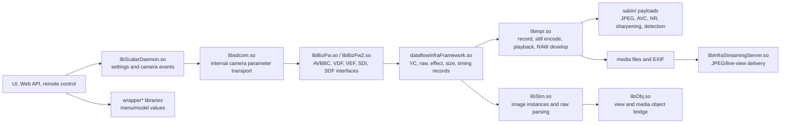

# Image and color processing boundary

Last updated: 2026-10-13

The earlier subsystem and network documents reached the imaging boundary from above. They documented camera-control commands, live-view state, JPEG retrieval, MTP media access, and the network streaming server. They did not map the color pipeline or the image-processing services behind those interfaces.

This note starts that map from the ILCE-6000 firmware 3.21 `nflasha15` inventory. The proprietary ELF files and non-ELF payloads remain in the private research archive. The public machine-readable companion is [`firmware-3.21-image-processing-map.json`](../analysis/exports/firmware-3.21-image-processing-map.json).

## Current boundary

The graph shows boundaries supported by names, imports, exported symbols, and direct `DT_NEEDED` edges. It does not yet prove the complete runtime load order or the exact path from the sensor front end to each accelerator payload.

## What was already covered

The previous documents covered three adjacent layers:

- [`06-subsystem-map.md`](06-subsystem-map.md) recorded Web API, remote-control, PTP/MTP, lens, and media service boundaries.
- [`08-network-stack.md`](08-network-stack.md) recorded the JPEG live-view producer/consumer boundary. `libInfraStreamingServer.so` obtains a JPEG frame through an internal message and maps it for delivery; it is not evidence that this library performs demosaic, color conversion, or JPEG encoding.
- [`07-usb-ptp-protocol-boundary.md`](07-usb-ptp-protocol-boundary.md) recorded how a host reaches camera services and media objects.

Those notes are useful entry points for feature work, but they stop before the processing implementation. The color/image pipeline was therefore only covered indirectly before this milestone.

## Confirmed static components

### Camera color and image settings

`libScalarDaemon.so` is the strongest current control-plane candidate. Its dynamic symbols include methods for:

- color mode and color-mode type;
- RGB matrix values and color depth for individual channels;
- white balance, white-balance shift, and white-balance lock;
- contrast, saturation, brightness, sharpness, and sharpness gain;
- color correction and manual lens color shading;
- color space and cinema tone;
- picture effects, including several effect-specific parameters;
- extended gamma table setup;
- image-filter operations such as HDR, art effect, contrast plus, soft focus, face noise reduction, and red-eye reduction.

The library directly depends on `libsdcom.so`. This is evidence of a parameter/event transport boundary. It does not establish that every setter reaches the still encoder or that the same setting affects live view, JPEG, movie, and playback paths identically.

The UI-side wrappers are separate. `wrapperCreativeStyle.so`, `wrapperWhiteBalance.so`, `wrapperImageQuality.so`, and `wrapperImageSize.so` convert model values and call the view/process-data layer. They expose settings and state translation rather than pixel-processing kernels. `cmn_view_processDataMgr.so` contains process-data elements for white balance, picture effect, and cinema tone.

### Shared YC and image metadata

`dataflowInfraFramework.so` defines the data records exchanged by the image graph. The exported API includes entries for:

- raw information;
- YC state and colorimetry;
- image size, valid/canvas/target sizes, data placement, compression, and scan properties;
- image output timing;
- display information;
- camera information;
- effect information, including color-effect and input-processing adjustment data;
- face information;
- movie encoder and movie-quality information.

This is a major porting seam. A new processing operation will likely need to preserve these records and their dataflow pin/message contracts even when the pixel operation itself runs in a lower-level component.

### Image instances and media operations

`libStm.so` manages image instances through deposit, withdraw, share, overwrite, parse, peek, poke, and raw-parse operations. Its symbols include `rawparseImageInstance` and `StmMain::execRawParse`. Its dependency on `dataflowInfraFramework.so` confirms that raw parsing and image-instance metadata share the YC/dataflow model.

`libmpr.so` is the media/recording boundary. Its symbols include:

- `MprIf::EncodeStill`;
- `MprIf::WriteStill` and `FlushWriteStill`;
- `MprIf::ReadStillSingle`;
- still playback and playback by address;
- `MprIf::PlayStillSingle` with `MPR::RawDevelopInfo`;
- `MprIf::SetRecDefinition`, `SetRecQuality`, `SetRecAspect`, and `SetRecXvYccInfo`;
- in-memory still-encode control commands.

`libObj.so` imports `MprIf::EncodeStill`, raw parsing, image-size records, output-timing records, and display records. Its direct dependencies include `libmpr.so`, `libmprctrl.so`, `libBizFw.so`, `libsencore.so`, and `libInfraMediaCommon.so`. This gives a stronger static path from view/control objects to the media and image-processing framework than the earlier network-only map.

The MPR static surface is broader than a single JPEG call. `libmpr.so` exports thin `MprIf::EncodeStill` entry points, feature-interface `FeaIf::EncodeStill`, still writing, playback, RAW development, and record-definition setters for quality, aspect, source, media target, face-detection metadata, and XvYCC information. `libObj.so` imports the encode and write interfaces together with `StmCh::rawparse` and the image-size records. This places MPR between the object/dataflow side and media storage, although the exact call chain into the codec payload is still unresolved.

The first full REA request for the 10.3 MiB `libmpr.so` exceeded the 330-second provider timeout during default Ghidra analysis. That is a tooling limitation, not evidence that the symbol is opaque or absent. The public map therefore records MPR as a confirmed static boundary and keeps the implementation/caller claim open.

## Deep-dive observations from REA

The first REA/Ghidra pass separates the control plane from the pixel and buffer planes.

The public evidence indexes are [`rea-image-scalar-rgbmatrix.json`](../analysis/evidence/rea-image-scalar-rgbmatrix.json), [`rea-image-scalar-filter-art.json`](../analysis/evidence/rea-image-scalar-filter-art.json), [`rea-image-scalar-gamma.json`](../analysis/evidence/rea-image-scalar-gamma.json), [`rea-image-scalar-wb-inherit.json`](../analysis/evidence/rea-image-scalar-wb-inherit.json), [`rea-image-stm-rawparse.json`](../analysis/evidence/rea-image-stm-rawparse.json), and [`rea-image-bizfw-decodejpeg.json`](../analysis/evidence/rea-image-bizfw-decodejpeg.json). They contain hashes and procedure identities only; full REA dossiers remain private.

### Color settings are typed event producers

The real `setRgbMatrix` implementation receives ten integer values, wraps them as typed numeric parameters, adds them to a system-parameter list, and emits one camera event. REA also recovered two callers: the camera-parameter command processor and an initialization patch routine. This connects both ordinary setting changes and startup initialization to the same event mechanism.

`filterArtEffect` follows the same pattern with five numeric values and one boolean. Its body only builds a typed parameter list and emits an image-filter event. The analyzed body contains no image-instance handle, pixel loop, buffer operation, or JPEG call. The strongest interpretation is that `libScalarDaemon.so` translates settings into event messages; a downstream service consumes those events and performs the image operation.

`setExtendedGammaTable` confirms that the pattern also applies to tone control. It accepts two numeric values and two booleans, converts the booleans to numeric mode flags, packages four typed parameters, and emits one camera event. The function does not contain a gamma lookup loop or table write, so the gamma data consumer remains downstream.

White balance adds a separate model/state layer. `CameraSettingInheritance::setWhiteBalanceParameters` looks up a mode in a bounded parameter table, obtains the corresponding entries from `ParameterStorage`, and updates those entries. For a small group of white-balance modes it queries model information and applies a returned offset before storing one of the values. This function does not emit the camera event itself, which implies that white-balance UI/model normalization and camera-event dispatch are distinct steps.

This is a useful porting boundary. A feature that reuses an existing processing primitive may need a new setting/model entry and a correctly shaped event. Modifying the scalar daemon alone is unlikely to add a new pixel algorithm.

### Raw parsing is an asynchronous metadata request

`STM::rawparseImageInstance` receives an image-instance identifier and an output structure. It creates a dataflow message, configures an asynchronous OSAL request, sends it through a `DataflowInfraSender`, waits through a `DataflowInfraReceiver`, checks the reply size and status, and copies a collection of fixed-width fields into the caller's result.

The observed body does not walk a pixel buffer. It is therefore a handle-to-metadata bridge rather than the raw conversion kernel. The image instance is an important object boundary: its identifier is passed into the dataflow request, while image dimensions, placement, and other raw-parse fields return through the shared dataflow contract.

### AVBBC decode is a service-channel wrapper

REA also traced `OBJAVBBCBASECLASS::SdfCh::decodeJpeg` in `libBizFw.so`. It validates the comparison, acknowledgement, and decode-command structures, fills a fixed command record, and calls the channel's `sendAndRcvAckCmp` helper. The function contains no JPEG coefficient loop or pixel transform. This places JPEG decode behind an AVBBC service-channel boundary, consistent with the named `sabin/sa_jpeg_dec_*` payloads being downstream engine assets rather than ordinary user-space library code.

### The current pipeline model

The evidence now supports this more precise model:

| Stage | Confirmed role | What remains open |
| --- | --- | --- |
| Setting/model | UI wrappers and process-data elements represent Creative Style, white balance, image quality, image size, picture effect, and cinema tone | Which model values map to which event parameters across modes |
| Event/control | `libScalarDaemon.so` builds typed parameter lists and emits camera or image-filter events | The service that receives each event and the complete event-to-mode table |
| Shared metadata | `dataflowInfraFramework.so` defines YC, raw, effect, colorimetry, size, timing, display, face, and movie records | Pin IDs, full message layouts, and producer/consumer ownership |
| Image instances | `libStm.so` manages image handles and requests raw-parse metadata asynchronously | The owner of the underlying image buffers and the sensor/ISP handoff |
| Media operations | `libmpr.so` exposes still encode, write/read, playback, RAW development, and record-definition operations | The encode caller chain and the exact handoff into codec/image engines |
| Processing payloads | `sabin/` contains named JPEG, AVC, noise-reduction, sharpening, detection, panorama, and table payloads | Loader, target processor, parameter ABI, and runtime mode selection |
| Delivery | streaming and MTP services retrieve completed JPEG/media objects | Whether live view, postview, and recorded JPEGs share the same upstream graph |

The key architectural distinction is now evidence-backed: color controls and effects are message producers, while `STM` exposes image metadata through an asynchronous dataflow service. The actual Bayer, demosaic, denoise, color-matrix, tone, and JPEG stages remain below these seams.

### Lower-level image/video payloads

The `sabin/` directory contains non-ELF binary payloads with names that identify processing roles. Confirmed payload groups include:

- JPEG encoder and decoder payloads;
- AVC encoder and decoder variants;
- low-frequency and chroma/noise-reduction candidates;
- sharpening, defect-detection, face-detection, and tracker candidates;
- still/movie display or conversion candidates and still/movie coefficient tables;
- panorama and frame-rate-conversion candidates.

The names are strong discovery evidence, not a recovered API. The payload headers, loader, target CPU/DSP instruction set, parameter blocks, and runtime selection logic still need to be identified. `libsencore.so` contains sensor-interface and diagnostic command symbols; its name alone must not be treated as proof that it is the image encoder.

### RAW and diagnostic paths

`CAMERA_SCN_EXTERNAL_RAW_RECORD.so` is an explicit RAW-record scenario module. Its strings and local symbols show RAW output on/off, device acquire/release, output functions, and synchronous OSAL messaging. `libInfraMediaCommon.so`, `libObj.so`, and `libsencore.so` also contain diagnostic boundaries for raw YC data, JPEG capture, display-DSP control, and partial raw YC reads.

These are promising laboratory paths because they may expose intermediate buffers. They are not yet evidence that the camera's ordinary RAW still path is externally accessible or that the saved ARW data is produced by this scenario module.

## What remains unknown

The current map still does not establish:

- the sensor driver or sensor-to-ISP handoff;
- the Bayer pattern and raw bit depth at each stage;
- black-level correction, defect correction, demosaic, white-balance gains, or the RGB color matrix implementation;
- tone/gamma table contents and the exact relationship between Creative Style, Picture Effect, and the extended gamma API;
- the JPEG quantization/subsampling choices and the caller that loads `sa_jpeg_enc_*`;
- which `sabin` payloads are loaded for still, movie, live view, playback, and panorama modes;
- the exact dataflow pin IDs, message IDs, and parameter structures;
- the process that loads `libScalarDaemon.so`, `libmpr.so`, and the image payloads;
- cross-version stability of these names, structures, and payload formats.

Absence of a symbol named `demosaic`, `Bayer`, or `color matrix` is not evidence that the operation is absent. The operation may be inside a stripped payload, a hardware command sequence, or a generic parameter/event method.

## Next research sequence

The next pass should follow one still-image path and one live-view path through the same lower layers:

1. Compare the recovered `libScalarDaemon.so` patterns across color mode, RGB matrix, extended gamma, white balance, and picture effect, recording only stable public parameter names and typed-argument counts.
2. Analyze the remaining `libStm.so` image-instance methods to recover ownership, sharing, overwrite, and buffer-lifetime semantics around the raw-parse request.
3. Complete the `libmpr.so` `MprIf::EncodeStill` and nearby caller analysis, then connect its parameters to `libBizFw.so` and `dataflowInfraFramework.so` records.
4. Identify the loader for `sabin/` payloads and decode only the payload header/manifest fields needed to associate each payload with a target engine and mode.
5. Use `libInfraStreamingServer.so` and `libInfraMtpServer.so` as output observers. Compare the same source frame delivered as live-view JPEG, postview JPEG, recorded JPEG, and RAW where available.
6. If an authorized camera is available, run controlled read-only captures with one setting changed at a time. Preserve the images privately, publish only derived measurements and hashes, and correlate EXIF, dimensions, JPEG markers, and pixel statistics with the static path.

The first high-value REA targets are `SystemEventIssuerCameraParameter::setRgbMatrix`, `setExtendedGammaTable`, `setWhiteBalanceParameters`, `SystemEventIssuerImageFilter::filterArtEffect`, `StmMain::rawparseImageInstance`, and the `MprIf::EncodeStill` caller chain. They are more likely to expose a stable porting boundary than the accelerator payloads themselves.

## Milestone record

This is the start of **M6 follow-up — image and color processing inventory**.

- **Status:** active; static boundary inventory complete and first control/dataflow functions traced for the initial 3.21 slice.
- **Evidence:** private `nflasha15` file tree, ELF dynamic symbols, `DT_NEEDED` metadata, and selected printable identifiers. The public companion map records hashes and derived roles.
- **Confirmed:** the control, dataflow, media, raw-scenario, output, and accelerator-payload boundaries listed above exist in the 3.21 extraction; REA shows RGB-matrix and art-effect calls becoming typed event messages, and raw parsing becoming an asynchronous dataflow request/response.
- **Strong inference:** `libScalarDaemon.so` is the camera-parameter/event control plane; `libStm.so` is a handle-to-metadata bridge; `libmpr.so` is the still/media operation boundary; `dataflowInfraFramework.so` is the shared YC/image metadata contract.
- **Unknown:** exact pixel algorithms, the event consumers, MPR caller chain, payload loader, buffer formats, and version stability.
- **Exit condition:** at least one still or live-view path traced from a color/image setting through dataflow/media processing to an output buffer, with a second firmware version or a controlled camera observation used to test stability.
